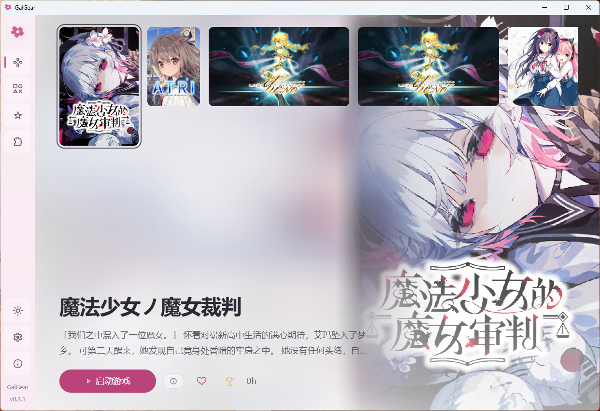
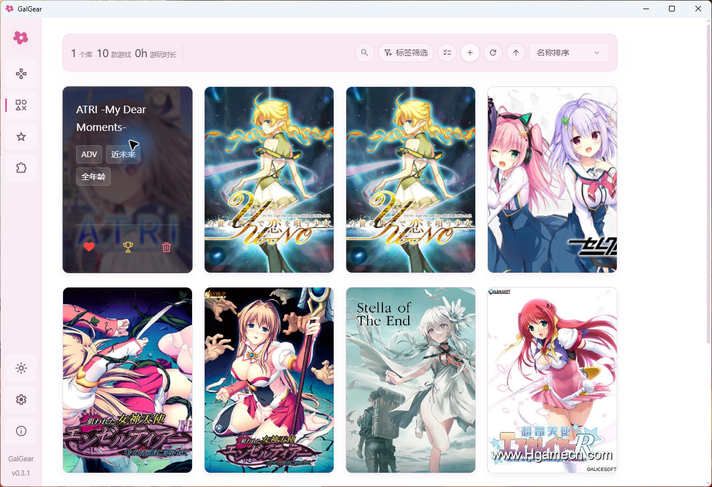
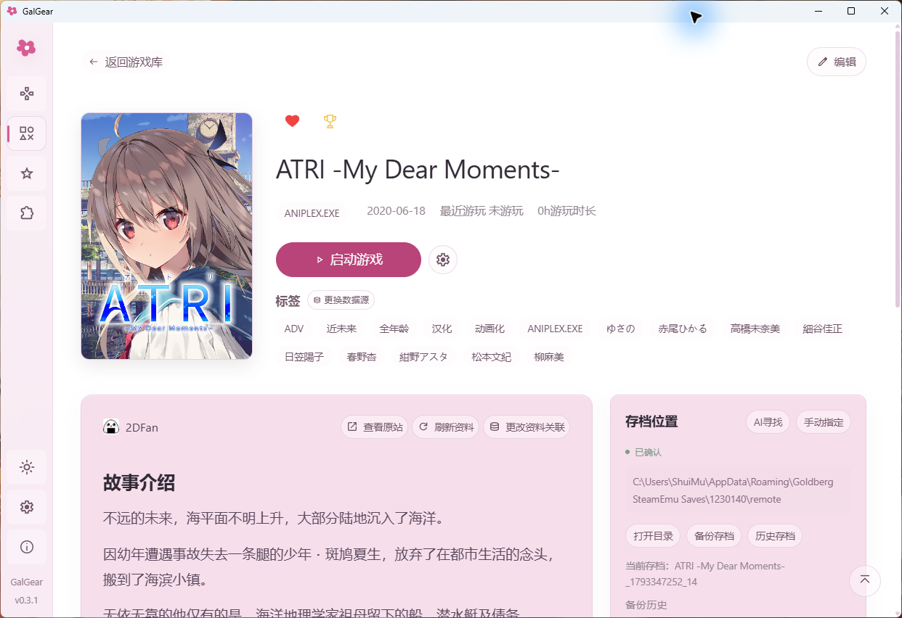
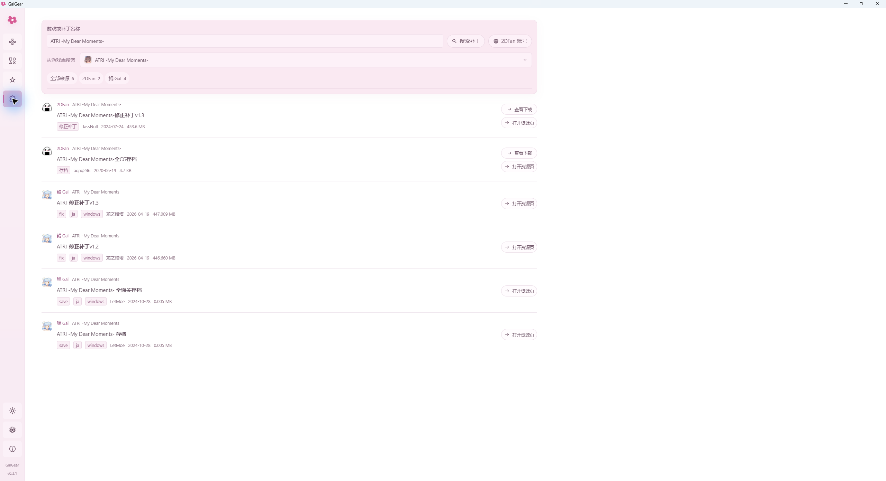

# GalGear

**A Galgame manager with locale emulation, upscaling, patch search and management, metadata from multiple sources, and AI-assisted save discovery.**

Windows x64 · 简体中文 / 日本語 / English

[简体中文](README.md) · [日本語](README.ja.md) · [English](README.en.md)

[Download](https://github.com/CbShuiMu/GalGear/releases/latest) · [Getting started](#getting-started) · [Features](#features) · [Report an issue](https://github.com/CbShuiMu/GalGear/issues)

GalGear is a local Galgame manager for Windows. Add your game folders to browse covers, find games, organize favorites, and launch games, with saves and patches managed in the same place.

All four screenshots below were captured from v0.3.1 running on October 31, 2026, and saved as lossless PNGs at their original resolution of 2560 × 1392. Click an image to view the original.

> The current release is **v0.3.3 (November 1, 2026)**, adding game screenshots and manual Skill updates, improving cover and folder actions, and switching the project license to GPL-3.0-only.

## Getting started

Download the Windows x64 version from [Releases](https://github.com/CbShuiMu/GalGear/releases/latest):

- **Installer**: download `GalGear_0.3.3_x64-setup.exe` and follow the installation prompts.
- **Portable**: download `GalGear-0.3.3-win64-portable.zip`, extract it, and run `GalGear.exe`.

For your first launch:

1. Add a game library and select the folder containing your games.
2. After scanning, use the confirmation window to choose each game's metadata source, matching title, and executable. You can save the games you have confirmed and handle the rest later.
3. Open the game details, check the launch configuration, and launch the game. To enable automatic backups, first launch the game and create a save.
4. Find and confirm the save location, then make a backup. This makes it easier to change patches, move to another computer, or replay a game later.

## Features

### Galgame management

Games can stay in different folders; there is no need to move them to use GalGear. Search by name, combine tag filters, sort your library, and use nested favorites folders to organize games you are playing, plan to play, or have finished. A game can belong to multiple favorites folders, with drag-and-drop and batch organization supported.

GalGear records playtime and when you last played. Tracking relies on detecting the game process, so keep GalGear running while you play.

Waifu2x denoises covers in the background and generates denoised 4K home backgrounds, preserving the aspect ratio with a 3840-pixel long edge. The feature is designed with a **laptop RTX 2060** as its minimum hardware target and processes one task at a time in small tiles. Images are replaced only after successful generation, and results are reused for identical covers. See [Cover enhancement](docs/cover-enhancement.md) for deployment and cache details (in Chinese).

### Tag filtering

Filter by tags covering everything from game attributes to voice actors listed in the game's metadata.

### Automatic metadata from multiple sources

Choose metadata from **2DFan, VNDB, Bangumi, 月幕 Galgame, 未萌 NextMoe, and KunGal**, with a different source available for each game. Synopses, developers, staff, and tags are stored locally and can also be edited manually. **Thanks to all these platforms.**

Search for covers separately by name, choose a different cover source, or use a local image without changing the linked game metadata. Click a tag, developer, or staff member in the details to find related games in your library. Cached metadata and your local library remain available offline.

The interface offers pink, white-pink, and white themes, each with light or dark mode. You can also adjust the language and font size in Settings.

### Game screenshots

Press the default shortcut **Shift+S** in a game and the screenshot is **automatically copied to the clipboard**. Switch to a chat window, document, or image editor that supports pasting images and press **Ctrl+V** to paste and share it directly.

Screenshots are enabled by default. Under **Settings → Paths and backups → Save backups and bundled tools**, you can enable or disable screenshots and change the shortcut, then save using the button at the top right of the card. The shortcut works only while a library game is in the foreground and GalGear is running. Choose another combination if it conflicts with the game's own shortcuts.

Screenshots are also saved as **lossless PNGs at the captured resolution**. For ordinary windows, the capture excludes the standard title bar and borders. With Magpie, it can capture the upscaled image at its actual output resolution. Images are named using UTC time and saved in `screenshots/` inside the game folder.

The **Recent screenshot** card on the game details page shows the latest image, with a button at the top right to open its folder. The preview may be smaller; the PNG on disk retains its original dimensions. If copying to the clipboard fails, the saved image remains available in the screenshot folder.

Windowed or borderless mode is recommended, with the entire game image visible on screen. Exclusive fullscreen, protected content, or third-party overlays may affect capture. Games running as administrator may require a Windows authorization prompt so GalGear can receive the screenshot shortcut.

### Cloud backups and save management

GalGear searches for saves in the game folder, AppData, Documents, and other locations. You can also specify locations manually.

After confirming the locations, you can back up multiple save folders, add notes to backups, or lock a backup to protect it from automatic cleanup. Automatic backups after a game exits can be enabled for each game.

A preview is shown before restoring, and the current saves are backed up first. Exit a running game before restoring saves or applying patches.

**WebDAV cloud backups** are also supported. Configure your connection under **Settings → Cloud storage** to upload saves manually, or download cloud backups into your local backup history and then restore them. When moving between computers, use the same game title on both. If there are multiple save locations, make sure their order matches as well. See [Cloud storage](docs/cloud-storage.md) for connection examples and instructions (in Chinese).

Uploads and downloads must be started manually; background automatic synchronization is not currently available.

### Patch search and management

Search for patch resources on **2DFan and KunGal**, read the original site's instructions, and download available direct links provided by the site. You can also import local patches. Resources requiring login or payment remain subject to the original site's account and access requirements. **Downloading resources from 2DFan requires a configured proxy.**

Select a game directly from your library to search for patches. The example below uses **ATRI -My Dear Moments-** from the library and shows patch and save results from both sources.

Local ZIP archives can be previewed directly; RAR and 7z archives use the bundled 7-Zip. File conflicts are listed before overwriting, and backups are kept for later restoration. EXE patches use their own installation process.

For extracted patches, place each patch in its own subfolder under `patch/` in the game folder. GalGear lists them on the details page so you can install or switch patches without copying files manually each time.

### AI-assisted save discovery

GalGear first scans a preset list of possible paths. AI-assisted save discovery supplements this scan. For a new game, launch it and create a save first, then exit and click the AI search button at the top right of the save card.

### AI story features (experimental)

An optional **AI story recap** is available. Configure an API token and model for DeepSeek, OpenAI, Qwen, or Kimi under **Settings → AI**, then enable AI analysis in the game's configuration editor. Initial preparation may take some time. Once it finishes, you can view the recap and your current progress on the details page.

An **AI route map** opens a generated map of branches and endings in your default browser. Route maps always use DeepSeek, which must be configured separately. The feature analyzes the full dialogue and may reveal later story events and endings.

These features are experimental. Save and script support varies by game, and generated summaries and routes may be inaccurate. When enabled, the dialogue, save information, and game metadata needed for analysis are sent to the corresponding AI service. API usage is billed to your own account. See [AI settings](docs/ai-settings.md) and [Story recaps](docs/ai-summary.md) for details (in Chinese).

## Data locations

| Data | Location |
| --- | --- |
| Configuration and game list for installed / normal runs | `%APPDATA%/com.galgear.desktop` |
| Configuration and game list in portable mode | `data/` beside the executable, enabled by `portable.flag` in the same folder |
| Save backups | `.galgear-backups/saves/` inside the game folder |
| Game screenshots | `screenshots/` inside the game folder (original-resolution PNGs) |
| AI preparation files and cache | `.galgear-ai-summary/` inside the game folder |

When moving a portable installation, keep the application folder, `data/`, `tools/`, and backups inside game folders. Skills are not bundled or checked at startup. Use Settings → Updates → Skill to check and install manually. The installed `Galgear-GalgameReverse-Skill/` folder beside the executable can also be moved.

Account tokens, cookies, and cloud storage passwords are stored in the local Windows Credential Manager and must be configured again on another computer. Removing a game from the library only changes the list; it does not delete the game, saves, or backups. For 2DFan, you need to obtain the token and cookies yourself.

## Usage notes

- GalGear manages local EXE games that are already installed. It does not provide games or mount or install disc images.
- Save detection does not support every engine; check the location before making your first backup. Locale Emulator and Magpie configuration paths can be changed under **Settings → Paths & backups**. Their behavior also depends on the game and your local environment.
- Resource downloads currently run one at a time, with no support for resuming interrupted downloads.

To report a problem, include the application version, reproduction steps, and error message in [Issues](https://github.com/CbShuiMu/GalGear/issues). Remove personal information when sharing anything related to saves or accounts.

Developer documentation (in Chinese): [Module structure](docs/architecture.md) · [Data source integration](docs/interface-and-data-sources-2026-10-14.md) · [Requirements](docs/requirements.md)

## Acknowledgments

GalGear uses the following open-source tools for several of its features. Thanks to their developers and maintainers:

- [Locale Emulator (LE)](https://github.com/xupefei/Locale-Emulator): launching games with an emulated locale.
- [Magpie](https://github.com/Blinue/Magpie): real-time game image scaling and upscaling.
- [waifu2x-ncnn-vulkan (waifu2x)](https://github.com/nihui/waifu2x-ncnn-vulkan): cover denoising and home background enhancement.
- [7-Zip](https://github.com/ip7z/7zip): extracting RAR, 7z, and other patch archives.

Each tool retains its original license and copyright notices. See [Bundled tools](docs/bundled-tools.txt) for usage notes and upstream source links (in Chinese).

## Release history

### v0.3.3

- Screenshots, manual Skill updates, and GPL-3.0-only licensing. See [release notes](docs/releases/v0.3.3.md).

### v0.3.2

- Added imports of PotatoVN, ReinaManager, and LunaBox library backups, plus PotatoVN-format exports.
- Improved verified data source selection, batch settings, save resource installation, and Magpie scaling profile configuration.
- Refined the home page, cover picker, and library layout. See the [release notes](docs/releases/v0.3.2.md) (in Chinese).

### v0.3.1

- Fixed the metadata and launcher confirmation window failing to reopen when games were re-added after removing a game or library.
- Fixed 2DFan patch downloads failing because of forced direct connections; downloads now follow system proxy settings.
- Hidden unconfirmed save candidates after a save location is confirmed, for both automatic detection and manual confirmation.
- Updated the application icon.

### v0.3.0

- Added in-app update checks and installation, with file size and SHA-256 verification, user data preservation, and rollback on failure.
- Added AI-assisted save location discovery and improved save detection, backup, restoration, and migration.
- Improved patch search, downloads, and local patch folder management; bundled a 7-Zip decoder.
- Refined library drag-and-drop, multi-selection, favorites, and toolbar layout, as well as game configuration and bundled tool management.
- Improved AI model capability detection and Skills checks. Skills continue to download at runtime as needed.

### v0.2.1

- Added a home page and gamepad navigation, with improvements to the library and configuration editor.
- Expanded metadata sources and AI providers, including Qwen and Kimi.
- Added cover enhancement and custom backgrounds, and improved play records.
- Added checks for the host and Skills in the application folder before enabling AI. Available features are enabled automatically after background updates finish. Download or verification failures preserve the previous version, show a notification, and retry on the next launch. New versions replace the whole directory, removing files deleted upstream. The first download requires network access and write access to the application folder; Git is not required.

### v0.2.0

- Added experimental AI story recaps and route maps. Route maps contain spoilers. Initial AI preparation typically took tens of minutes and cost around CNY 2 through the DeepSeek API; subsequent uses of the route map or recap cost around CNY 0.1 each. These are historical estimates from this release.
- Added WebDAV cloud backups.
- Added VNDB, Bangumi, and 月幕 Galgame as metadata sources, configured under **Settings → Data sources**.

### v0.1.0

- Added dark mode.
- Added patch search on 2DFan and KunGal using games selected from the library. The patches tab can be disabled under **Settings → System**.

GalGear is available under the [GPL-3.0-only License](LICENSE). Third-party tools, icons, and metadata are subject to their respective licenses and terms of use.
