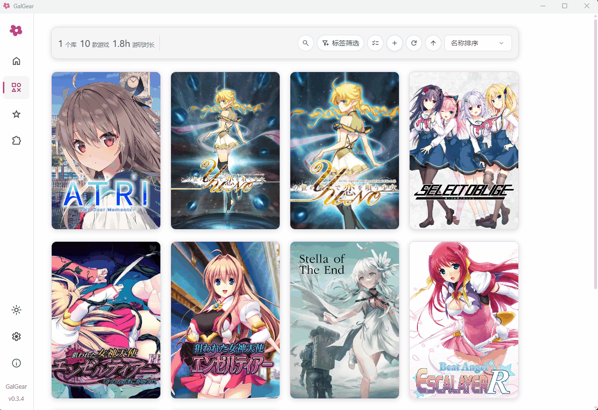
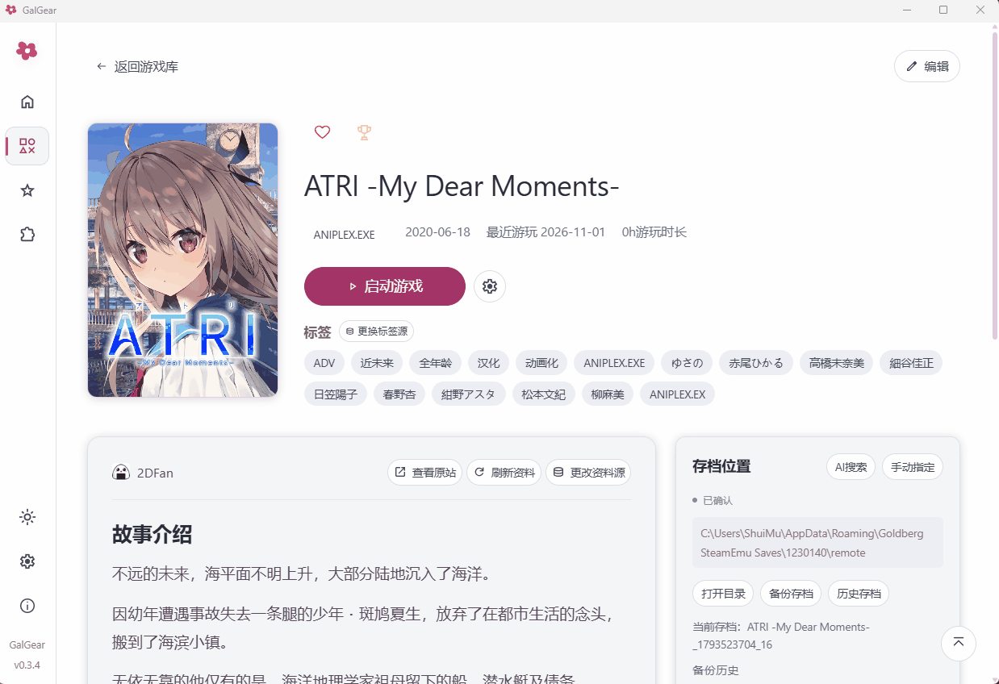
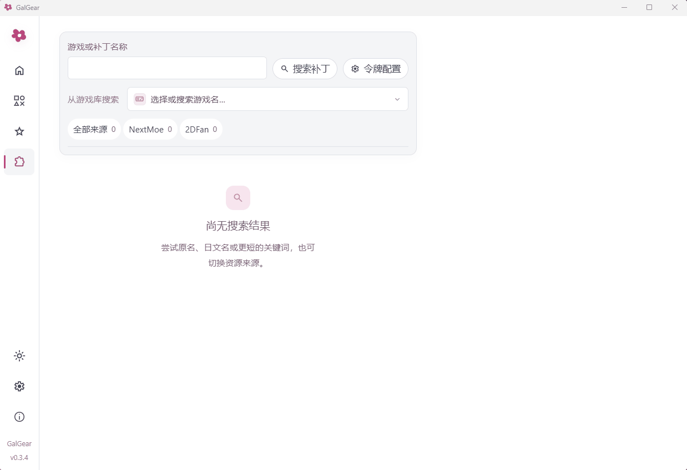

# 🌸 GalGear

**Galgame に特化した管理ツール。ロケールエミュレーション、超解像、パッチの検索・管理、複数ソースからの作品情報取得、AI によるセーブデータ検索に対応。**

Windows x64 · 対応表示言語：简体中文 / 日本語 / English

[简体中文](README.md) · [日本語](README.ja.md) · [English](README.en.md)

交流・フィードバック用 QQ グループ：607755362

[ダウンロード](https://github.com/CbShuiMu/GalGear/releases/latest) · [クイックスタート](#-クイックスタート) · [機能紹介](#-機能紹介) · [不具合の報告](https://github.com/CbShuiMu/GalGear/issues)

GalGear は、Windows 向けのローカル Galgame 管理ツールです。ゲームフォルダーを追加するだけで、カバー画像の表示、ゲームの検索、お気に入りの整理、ゲームの起動ができます。セーブデータとパッチも同じ場所で管理できます。

> **v0.4.1（2026-11-08）** では共通のセーブバックアップ先を設定できるようになり、オフライン時のライブラリ管理、別名検索、プレイ時間の記録を改善しました。

## 🚀 クイックスタート

[Releases](https://github.com/CbShuiMu/GalGear/releases/latest) から Windows x64 版をダウンロードしてください。

- **インストーラー版**：`GalGear_0.4.1_x64-setup.exe` をダウンロードし、案内に従ってインストールします。
- **ポータブル版**：`GalGear-0.4.1-win64-portable.zip` をダウンロードして展開し、`GalGear.exe` を実行します。

初回起動時は、次の手順で設定できます。

1. ゲームライブラリを追加し、ゲームを保存しているフォルダーを選びます。
2. スキャン後の確認画面で、各ゲームの情報ソース、対応する作品、起動プログラムを選びます。確認できたゲームだけ先に保存し、残りは後で設定することもできます。右上の**一括変更**で一覧の情報ソースをまとめて変更し、**自動検索**で一致度の高い候補を取得できます。誤った候補がないか、自動検索後に必ず確認してください。
3. ゲームの詳細画面で起動設定を確認してから起動します。自動バックアップを有効にするには、ゲームを起動して一度セーブする必要があります。

## ✨ 機能紹介

| 機能 | 内容 |
| --- | --- |
| ゲーム管理 | 複数フォルダー、タイトルと別名の検索、並べ替え、階層型のお気に入り、ドラッグ＆ドロップに対応。利用できないゲームも一覧に残し、ドライブの接続状態が変わると再スキャンします。ホームはライブラリと同じ順序で、最終プレイ日を表示します。 |
| タグ・情報 | 声優、原画家、シナリオ担当などのスタッフタグと、タグの組み合わせで絞り込み。未萌 NextMoe、KunGal、VNDB、Bangumi、月幕 Galgame、2DFan の作品情報に対応し、カバーの個別検索やローカル画像も利用できます。各プラットフォームに感謝します。 |
| 内蔵ロケール変更・超解像 | 既定では無効です。ゲーム設定で必要に応じて Locale Emulator によるロケール変更や Magpie によるリアルタイム拡大を有効にできます。 |
| カバー・テーマ | Waifu2x がバックグラウンドでノイズを除去し、ホーム背景を 4K にアップスケール。テーマ、明暗モード、言語、文字サイズを設定可能。[詳細](docs/cover-enhancement.md)。 |
| フォント Hook・パネル | 登録ゲームが前面にあるとき、既定の **Shift+T** でパネルを開き、フォント、サイズ、幅、字間、行間、太さを調整。SimpleFontHook の互換ビルドで適用し、文字セット偽装や文字マッピングにも対応。結果はエンジンに依存します。[詳細](docs/font-tools.md)。 |
| 撮影・共有 | **Shift+S で撮影 → クリップボードへ自動コピー → Ctrl+V で貼り付け・共有**。元の解像度の可逆 PNG も保存し、Magpie モードでの撮影とゲーム詳細下部の最新画像プレビューに対応。 |
| バックアップ | 設定した共通フォルダーにゲーム名と保存日時ごとに保存します。複数フォルダー、メモ、ロック、復元プレビュー、終了後の自動バックアップに対応。既存のバックアップは検証後に移行します。WebDAV 転送は手動です。[バックアップとクラウドストレージ](docs/cloud-storage.md)。 |
| パッチ管理 | **ライブラリと連携**：登録ゲームを選んで検索し、ゲーム内のパッチフォルダーに直接保存できます。NextMoe のホスト済みファイルの取得には `moyu:files` 権限のアプリキーが必要です。KunGal・2DFan の検索、ローカルパッチ、ZIP / RAR / 7z の自動展開、競合確認と復元に対応。2DFan のダウンロードにはプロキシとアカウントトークンが必要です。ポイント不要で直接リンクを提供する NextMoe のパッチ取得を推奨します。 |
| AI（試験中） | **AI によるセーブデータの保存場所検索**、あらすじ、ゲーム攻略ルートマップ。自分の API トークンが必要で、必要なゲーム文章を送信し利用料が発生します。ルートマップにはネタバレを含む場合があります。[AI 設定](docs/ai-settings.md)。あらすじとルートマップは試験中です。初めて AI セーブ検索を使う前に、ゲームを起動して一度セーブしてください。 |
| ブラウザー認証 | Bangumi・NextMoe の内蔵 OAuth ログイン。ユーザートークンは Windows 資格情報マネージャーに保存。[詳細](docs/oauth-callback.md)。 |
| 更新通知 | 起動後に GalGear と Skill の版をバックグラウンド確認。更新を選んだときだけダウンロード・インストールします。 |
| データのインポート | PotatoVN、ReinaManager、LunaBox などに対応。 |
| 実行ログ | アプリ横の `logs/` に起動・コマンド・異常の診断を記録。自動送信はありません。[詳細](docs/runtime-logs.md)。 |

機能紹介の詳細と制限

### 🎮 Galgame の管理

ゲームが複数のフォルダーに分かれていても、そのまま利用できます。GalGear のために移動する必要はありません。名前による検索、タグを組み合わせた絞り込み、並べ替えに対応し、階層化したお気に入りフォルダーでプレイ中・プレイ予定・クリア済みの作品を整理できます。1本のゲームを複数のお気に入りフォルダーに登録でき、ドラッグ＆ドロップや一括整理も可能です。

プレイ時間と最終プレイ日時を記録します。計測にはゲームプロセスの検出を利用するため、プレイ中は GalGear を起動したままにしてください。

Waifu2x がバックグラウンドでカバー画像のノイズを除去し、ホーム画面用のノイズ除去済み 4K 背景を生成します。縦横比を維持し、長辺を3840ピクセルにします。**ノート PC 向け RTX 2060** を最低構成の設計目標とし、小さなタイルに分けて1件ずつ処理します。生成に成功した場合のみ画像を置き換え、同じカバー画像には処理結果を再利用します。配置とキャッシュについては [カバー画像の強化](docs/cover-enhancement.md)（中国語）をご覧ください。

### 🏷️ タグによる分類

ゲームのタグから作品情報に含まれる声優まで、さまざまな属性をタグで絞り込めます。

### 🔎 複数ソースから作品情報を自動取得

**2DFan、VNDB、Bangumi、月幕 Galgame、未萌 NextMoe、KunGal** から情報ソースを選択でき、ゲームごとに異なるソースを使えます。あらすじ、制作ブランド、スタッフ、タグはローカルに保存され、手動で編集することもできます。**各プラットフォームに感謝します。**

カバー画像は作品情報とは別に名前で検索でき、別のソースやローカル画像に変更しても、関連付けた作品情報には影響しません。詳細画面のタグ、制作ブランド、スタッフをクリックすると、ライブラリ内の関連作品を探せます。キャッシュ済みの作品情報とローカルライブラリはオフラインでも閲覧できます。

テーマカラーはピンク、ホワイトピンク、ホワイトの3種類で、それぞれライトモードとダークモードを選べます。言語と文字サイズも設定で変更できます。

### 🔤 ゲーム内フォント Hook とフローティングパネル

登録ゲームが前面にあるとき、既定の **Shift+T** で Rust のネイティブパネルを表示・非表示にできます。システムフォント、高さ、幅、字間、行間、太さを調整し、必要に応じて垂直メトリクス、文字セット偽装、旧字形・繁簡マッピングも設定できます。ゲームと同じビット数の Hook は「ゲームに適用」を押したときだけ読み込み、パネルを開くだけでは読み込みません。成功した設定はゲームごとに保存しますが、実際の再描画や表示結果はエンジンに依存します。ショートカットは「設定 → パスとバックアップ → バックアップと内蔵ツール」で変更し、カードを保存すると有効になります。

フォント置換は [SuQiandYing の SimpleFontHook](https://github.com/SuQiandYing/SimpleFontHook) を利用します。GalGear は独自のパネル、IPC、ローダー、互換パッチを提供し、上流と Detours の MIT 著作権表示・許諾文を原文のまま保持します。各コンポーネントのライセンスは変更しません。[機能と制限](docs/font-tools.md)。

### 📸 ゲームのスクリーンショット

ゲーム中に既定のショートカット **Shift+S** で撮影すると、画像が**自動でクリップボードにコピー**されます。画像の貼り付けに対応したチャット、文書、画像編集ソフトに切り替え、**Ctrl+V** を押すだけで貼り付けて共有できます。

撮影機能は既定で有効です。**設定 → パスとバックアップ → セーブデータのバックアップと内蔵ツール**で撮影の有効・無効やショートカットを変更し、カード右上のボタンで保存してください。ライブラリに登録したゲームが前面にあり、GalGear が起動している間だけ有効です。ゲーム側の操作と競合する場合は、別のキーの組み合わせに変更できます。

画像は同時に**撮影時の解像度のまま、可逆圧縮の PNG** でも保存します。通常のウィンドウでは標準タイトルバーと枠を除いたゲーム画面を撮影し、Magpie 使用時は拡大後の実際の出力解像度で撮影できます。ファイル名には UTC 時刻を使い、ゲームフォルダー内の `screenshots/` に保存します。

ゲーム詳細の「最新のスクリーンショット」カードに最新画像が表示され、右上のボタンから保存先を開けます。プレビューは縮小される場合がありますが、保存した PNG のサイズは変わりません。クリップボードへのコピーに失敗しても、保存済みの画像はスクリーンショットフォルダーに残ります。

ゲーム画面全体がディスプレイ内に収まるウィンドウまたはボーダーレス表示を推奨します。排他的フルスクリーン、保護された画面、他のアプリのオーバーレイは撮影に影響する場合があります。管理者権限で動作するゲームでは、ショートカットを受け取るために Windows の権限確認が表示される場合があります。

### ☁️ クラウドバックアップとセーブデータ管理

ゲームフォルダー、AppData、「ドキュメント」などからセーブデータを検索します。保存場所を手動で指定することもできます。

保存場所を確認すると、複数のセーブデータフォルダーのバックアップ、バックアップへのメモの追加、自動整理で削除されないようにするロックが利用できます。ゲーム終了後の自動バックアップもゲームごとに有効にできます。

復元前にはプレビューを表示し、現在のセーブデータを先にバックアップします。ゲームが動作中の場合は、終了してから復元やパッチの適用を行ってください。

**WebDAV によるクラウドバックアップ**にも対応しています。**設定 → クラウドストレージ**で接続を設定すると、セーブデータを手動でアップロードしたり、クラウドのバックアップをローカルの履歴にダウンロードしてから復元したりできます。別の PC では同じゲームタイトルを使用してください。保存場所が複数ある場合は、その順序も合わせる必要があります。接続例と操作手順は [クラウドストレージ](docs/cloud-storage.md)（中国語）をご覧ください。

アップロードとダウンロードは手動操作です。現時点ではバックグラウンドでの自動同期には対応していません。

### 🧩 パッチの検索と管理

**2DFan、KunGal、NextMoe** のパッチを検索し、配布元の説明を確認して、サイトが提供する利用可能な直接リンクからダウンロードできます。ローカルのパッチもインポートできます。ログインや支払いが必要なものは、引き続き配布元のアカウントとアクセス権限に従います。**2DFan のリソースをダウンロードするには、プロキシの設定が必要です。**

ライブラリから作品を選んで、そのままパッチを検索できます。画面プレビューのパッチ画像では、ライブラリ内の **ATRI -My Dear Moments-** を選択し、2つのソースのパッチとセーブデータの検索結果を表示しています。

ローカルの ZIP は直接プレビューできます。RAR / 7z は同梱の 7-Zip を使用します。ファイルを上書きする前に競合を表示し、後で復元できるようバックアップを残します。EXE 形式のパッチは、そのパッチ独自のインストール手順を使用します。

展開済みのパッチは、ゲームフォルダー内の `patch/` に、パッチごとのサブフォルダーを作って配置できます。詳細画面に一覧表示されるため、毎回手動でファイルをコピーせずにインストールや切り替えができます。

### 📁 AI によるセーブデータ検索

まず、あらかじめ設定された候補パスをスキャンします。AI による検索は、その補助手段です。新しいゲームで利用する場合は、ゲームを起動して一度セーブし、終了後にセーブデータカード右上の AI 検索をクリックしてください。

### 🤖 AI によるストーリー機能（試験中）

任意で使える **AI によるこれまでのあらすじ**機能を用意しています。**設定 → AI** で DeepSeek、OpenAI、Qwen、Kimi のいずれかの API トークンとモデルを設定し、ゲームの設定編集画面で AI 分析を有効にしてください。初回の準備には時間がかかる場合があります。完了後、詳細画面であらすじと現在の進行状況を確認できます。

**AI ルートマップ**では、生成した分岐とエンディングの図を既定のブラウザーで開きます。ルートマップは DeepSeek 専用のため、別途 DeepSeek の設定が必要です。台詞全体を解析するため、先の展開やエンディングのネタバレが含まれる可能性があります。

これらの機能は試験段階です。セーブデータやスクリプトを読み取れるかどうかはゲームによって異なり、生成されるあらすじやルートにも誤りが含まれる場合があります。有効にすると、解析に必要なゲームの台詞、セーブデータの情報、作品情報を該当する AI サービスへ送信します。API の利用料金はご自身のアカウントに課金されます。詳細は [AI 設定](docs/ai-settings.md) と [あらすじ機能](docs/ai-summary.md)（いずれも中国語）をご覧ください。

## 🖼️ 画面プレビュー

画像は v0.3.1（2026-11-5）の画面です。クリックすると原寸で表示できます。

その他の画面：ゲーム詳細・パッチ管理

## 🗂️ データの保存場所

| 内容 | 保存場所 |
| --- | --- |
| インストーラー版・通常起動時の設定とゲーム一覧 | `%APPDATA%/com.galgear.desktop` |
| ポータブルモードの設定とゲーム一覧 | 実行ファイルと同じ場所の `data/`。同じフォルダーの `portable.flag` で有効化 |
| セーブデータのバックアップ | アプリのデータフォルダー内の `save-backups/<ゲーム名>/<YYYY-MM-DD-HH-mm>/`。「設定 → パスとバックアップ」で保存先を変更可能。同じ分に複数保存する場合は `-2`、`-3` を付加 |
| ゲームのスクリーンショット | ゲームフォルダー内の `screenshots/`（元の解像度の PNG） |
| AI の準備ファイルとキャッシュ | ゲームフォルダー内の `.galgear-ai-summary/` |

ポータブル版を移動する際は、アプリ、`data/`、`tools/`、設定した共通バックアップフォルダー、インストール済みの `Galgear-GalgameReverse-Skill/` を保持してください。起動時に GalGear と Skill の版をバックグラウンド確認し、自動インストールせず更新通知を表示します。Skill は同梱されません。「設定 → 更新 → Skill」の更新ボタンでインストールしてください。

アカウントのトークン、Cookie、クラウドストレージのパスワードは、ローカルの Windows 資格情報マネージャーに保存されます。別の PC では再設定が必要です。項目を完全に削除すると、詳細、設定、コレクションへの登録、プレイ履歴が削除され、再利用には再インポートが必要です。ゲーム本体、セーブデータ、バックアップは削除されません。利用できないゲームも一覧に残り、ドライブの接続状態が変わるとバックグラウンドで再スキャンします。2DFan のトークンと Cookie は、ご自身で取得する必要があります。

## 📌 利用上の注意

- GalGear は、インストール済みのローカル EXE ゲームを管理します。ゲーム本体の提供や、ディスクイメージのマウント・インストールは行いません。
- セーブデータの検出は、すべてのエンジンに対応しているわけではありません。初回バックアップ前に保存場所を確認してください。Locale Emulator と Magpie の設定パスは、**設定 → パスとバックアップ**で変更できます。動作はゲームとローカル環境にも依存します。
- リソースのダウンロードは現在1件ずつ処理します。中断したダウンロードの再開には対応していません。

問題が発生した場合は、アプリのバージョン、再現手順、エラーメッセージを [Issues](https://github.com/CbShuiMu/GalGear/issues) にお知らせください。セーブデータやアカウントに関する情報を共有する際は、個人情報を取り除いてください。

開発資料（中国語）：[モジュール構成](docs/architecture.md) · [データソースの連携](docs/interface-and-data-sources-2026-10-14.md) · [要件記録](docs/requirements.md)

## 🙏 謝辞

GalGear の一部の機能では、以下のオープンソースツールを利用しています。各プロジェクトの開発者とメンテナーに感謝します。

- [SimpleFontHook — SuQiandYing](https://github.com/SuQiandYing/SimpleFontHook)：フォント Hook の上流実装。MIT ライセンスの[原文](docs/licenses/SuQiandYing-MIT.txt)を互換ビルドに保持しています。
- [Microsoft Detours](https://github.com/microsoft/Detours)：Hook で利用する API インターセプトライブラリ。[Microsoft MIT 許諾文](docs/licenses/Detours-MIT.txt)を保持しています。
- [Locale Emulator（LE）](https://github.com/xupefei/Locale-Emulator)：ゲーム起動時のロケールエミュレーション。
- [Magpie](https://github.com/Blinue/Magpie)：ゲーム画面のリアルタイム拡大・アップスケーリング。
- [waifu2x-ncnn-vulkan（waifu2x）](https://github.com/nihui/waifu2x-ncnn-vulkan)：カバー画像のノイズ除去とホーム画面の背景強化。
- [7-Zip](https://github.com/ip7z/7zip)：RAR、7z などのパッチアーカイブの展開。

SimpleFontHook と Detours の MIT ライセンスでは、ソフトウェアの複製または重要な部分に著作権表示と許諾文を含める必要があります。インストーラーとポータブル版には、両方の原文を `tools/font-hook/` に同梱しています。各ツールの元のライセンスと著作権表示を保持しています。使い方と上流ソースへのリンクは [内蔵ツールの説明](docs/bundled-tools.txt)（中国語）をご覧ください。

## 📝 更新履歴

### v0.4.1

- 共通のセーブバックアップ先と既存データの移行に対応しました。オフラインのゲームを一覧に残し、ドライブの変化に応じて再スキャンします。タイトル・別名検索、ランチャーからゲーム本体への引き継ぎの検出、ホームの並べ替え、作品情報とタグの編集、プレイ時間の表示を改善しました。[リリースノート](docs/releases/v0.4.1.md)。

### v0.4.0

- ゲーム内フォント Hook、Shift+T パネル、実行ログを追加。SimpleFontHook と Detours の MIT 許諾文を同梱。[リリースノート](docs/releases/v0.4.0.md)。

### v0.3.4

- NextMoe のダウンロードと内蔵 OAuth ログインを追加。セーブ検出、ホーム背景、更新通知を改善。[リリースノート](docs/releases/v0.3.4.md)。

### v0.3.3

- スクリーンショット、Skill の手動更新、GPL-3.0-only への変更。[リリースノート](docs/releases/v0.3.3.md)。

### v0.3.2

- PotatoVN、ReinaManager、LunaBox のライブラリバックアップのインポートと、PotatoVN 形式でのエクスポートに対応しました。
- 検証済みデータソースの選択、一括設定、配布セーブデータのインストール、Magpie のスケーリングプロファイル設定を改善しました。
- ホーム画面、カバー画像の選択、ライブラリのレイアウトを改善しました。詳細は [リリースノート](docs/releases/v0.3.2.md)（中国語）をご覧ください。

### v0.3.1

- ゲームやライブラリを削除した後に再追加した際、作品情報と起動プログラムの確認画面が再表示されない問題を修正しました。
- 2DFan のパッチダウンロードで直接接続が強制され、接続に失敗する問題を修正しました。システムのプロキシ設定に従います。
- セーブデータの保存場所を確認した後は、自動検出・手動確認のどちらでも、未確認の候補を非表示にしました。
- アプリのアイコンを更新しました。

### v0.3.0

- アプリ内でのバージョン確認と更新に対応しました。ファイルサイズと SHA-256 を検証し、ユーザーデータを保持して、失敗時にはロールバックします。
- AI によるセーブデータの保存場所検索を追加し、検出、バックアップ、復元、移行を改善しました。
- パッチ検索、ダウンロード、ローカルパッチフォルダーの管理を改善し、7-Zip デコーダーを同梱しました。
- ライブラリのドラッグ＆ドロップ、複数選択、お気に入り、ツールバーの配置を改善し、ゲーム設定と内蔵ツールの管理を充実させました。
- AI モデルの機能判定と Skills の確認を改善しました。Skills は引き続き、実行時に必要に応じてダウンロードします。

### v0.2.1

- ホーム画面とゲームパッド操作を追加し、ライブラリと設定編集画面を改善しました。
- 情報ソースと AI プロバイダーを拡充し、Qwen と Kimi に対応しました。
- カバー画像の強化とカスタム背景を追加し、プレイ記録を改善しました。
- AI を有効にする前に、アプリフォルダー内のホストと Skills を確認するようにしました。バックグラウンド更新の完了後、利用可能な機能を自動で有効にします。ダウンロードや検証に失敗した場合は旧版を保持して通知し、次回起動時に再試行します。新版はフォルダー全体を置き換え、上流で削除された古いファイルも削除します。初回ダウンロードにはネット接続とアプリフォルダーへの書き込み権限が必要です。Git のインストールは不要です。

### v0.2.0

- 試験的な AI あらすじ・ルートマップ機能を追加しました。ルートマップにはネタバレが含まれます。当時の目安では、初回準備に数十分、DeepSeek API の利用料に平均約2人民元、その後のルートマップ・あらすじの利用は1回あたり約0.1人民元かかりました。
- WebDAV によるクラウドバックアップに対応しました。
- 作品情報の取得元に VNDB、Bangumi、月幕 Galgame を追加しました。**設定 → データソース**で設定できます。

### v0.1.0

- ダークモードを追加しました。
- ライブラリからゲームを選び、2DFan・KunGal のパッチを検索できるようにしました。パッチタブは **設定 → システム**で非表示にできます。

GalGear は [GPL-3.0-only ライセンス](LICENSE)で公開されています。第三者のツール、アイコン、作品情報には、それぞれのライセンスと利用規約が適用されます。
