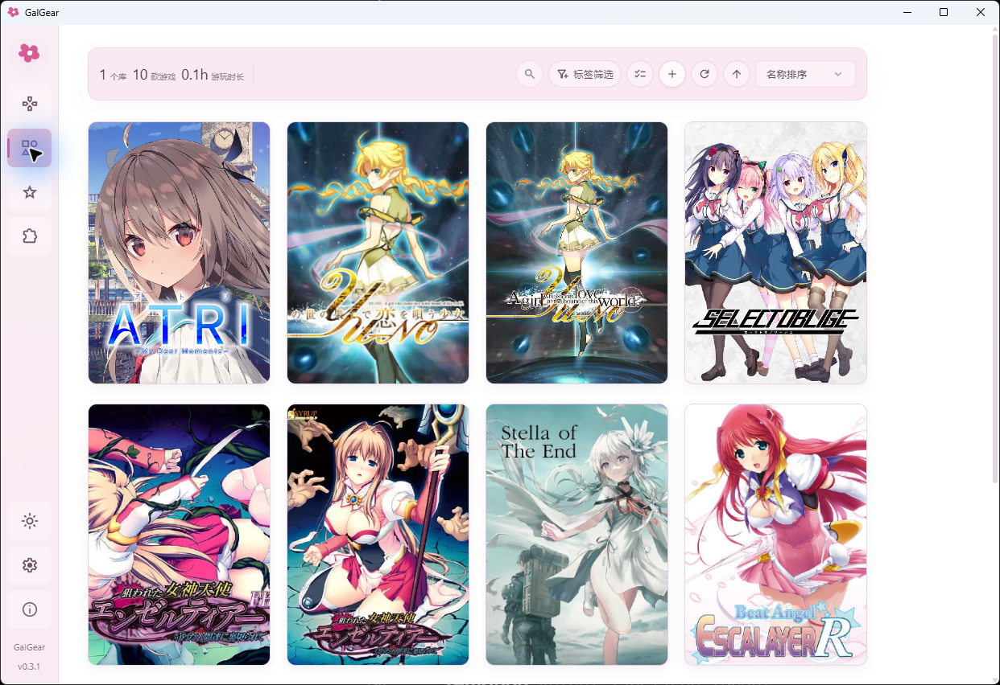
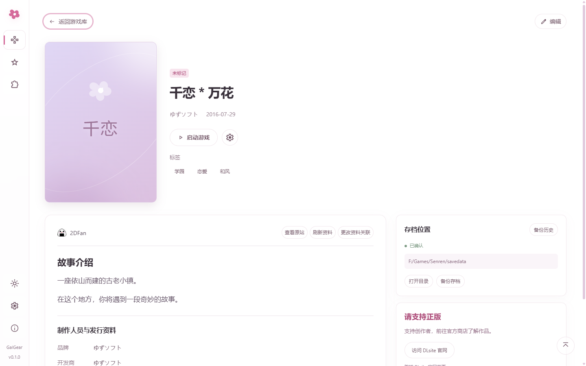
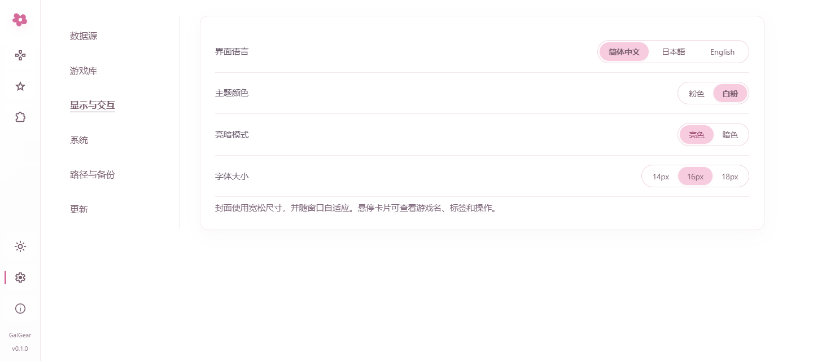
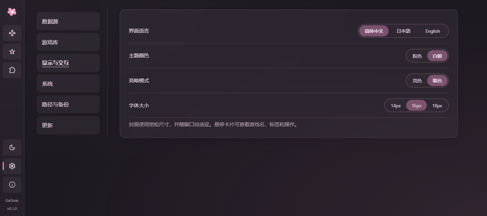

# GalGear

**GalGame游戏管理器，转区超分，补丁搜索管理**

Windows x64 · 简体中文 / 日本語 / English

[下载](https://github.com/CbShuiMu/GalGear/releases/latest) · [开始使用](#开始使用) · [功能介绍](#能做些什么) · [反馈问题](https://github.com/CbShuiMu/GalGear/issues)

GalGear 是一个 Windows 上的本地 Galgame 管理工具。把游戏目录加进来，就能看封面、找游戏、整理收藏夹、启动游戏，也能在同一个地方管理存档和补丁。

游戏库界面。截图来自 v0.1.0，使用演示条目和占位封面。

> 这份说明对应正在开发的 `develop` 分支。目前可下载的发行版是 **v0.2.0（2026-10-15）**；
> 新增下文的游玩时长、WebDAV 云备份、AI 前情提要和路线图等新功能

## 开始使用

前往 [Releases](https://github.com/CbShuiMu/GalGear/releases/latest) 下载 Windows x64 版本：

- **安装版**：下载 `GalGear_0.2.0_x64-setup.exe`，按提示安装。
- **便携版**：下载 `GalGear-0.2.0-win64-portable.zip`，解压后运行 `GalGear.exe`。

需要 Microsoft Edge WebView2 Runtime。目标系统为 Windows 10 / 11，Windows 10 还没有完成实机验证。仓库目前为私有，下载时需要登录有访问权限的 GitHub 账号。

第一次打开，可以按这个顺序来：

1. 点击游戏库右上角的 **添加**，选择放游戏的文件夹；也可以手动添加某个Galgame的 EXE。
2. 扫描后，在确认窗口里为游戏选好资料来源、对应作品和启动程序。可以先保存已经确认的几款，其余稍后再处理。
3. 打开游戏详情，检查启动配置，点击启动。需要转区或超分时，再配置 Locale Emulator 或 Magpie。
4. 找到存档位置并确认，做一份备份。以后换补丁、换电脑或重玩，都方便一些。

上面的批量确认窗口是开发版的新流程；v0.1.0 可以在游戏详情里关联资料、调整启动程序。

## 能做些什么

### Galgame管理

游戏可以放在不同目录，不必为了使用 GalGear 重新搬家。支持按名称搜索、组合标签筛选和排序，也可以用多层收藏夹整理正在玩、想玩或已经通关的作品。一款游戏能放进多个收藏夹，支持拖放和批量整理。

开发版会记录游玩时长和最近游玩时间。计时依赖 GalGear 对游戏进程的检测，玩游戏时请保持 GalGear 运行。

### 自动刮削来自多个数据源

作品资料可从 **2DFan、VNDB、Bangumi、月幕 Galgame、未萌NextMoe、KunGal** 中选择，每款游戏可以使用不同来源。简介、制作组、制作人员和标签会保存在本地，也可以自己修改。

在“设置 → 数据源”中可将 **未萌NextMoe** 设为默认来源；支持匿名查询，也可保存自己的 API Key。密钥仅存入本机 Windows 凭据管理器。接口说明见 [NextMoe API v2](https://developer.nextmoe.dev/docs/v2)。

封面可以单独按名称搜索、换来源挑选，或使用本地图片，不影响已经关联的作品资料。点击详情里的标签、制作组或制作人员，就能回到游戏库找相关作品。已经缓存的资料和本地游戏库可以离线浏览。  

开发版会在后台对封面去噪，并生成经过降噪的首页 4K 背景（保持原比例，长边 3840）。这项功能以 **笔记本 RTX 2060** 为最低配置设计目标，采用小分块、单任务处理；生成成功后才替换，相同封面会复用结果。部署与缓存说明见 [封面增强](docs/cover-enhancement.md)。

**感谢以上提到的平台。**

看看游戏详情和主题设置

截图来自 v0.1.0。界面支持粉色、白粉两种主题色，可分别搭配亮色或夜间模式；语言和字号也能在设置中调整。

### 云上存档/存档管理

GalGear 会寻找游戏目录、AppData 和“文档”等位置里的存档，也允许手动指定。  

确认位置后，可以备份多个存档目录、给备份写备注，或锁定一份不想被自动清理的记录。也可以按游戏开启退出后的自动备份。

恢复前会先展示预览，并备份当前存档。游戏正在运行时，请先退出再恢复或应用补丁。

新版还支持 **WebDAV 云备份**：在“设置 → 云存储”里填好连接，便能手动上传存档，或把云端备份下载到本地历史，再选择恢复。换电脑时，两边使用相同的游戏标题；有多个存档位置的，确认顺序也要一致。连接示例和具体步骤见 [云存储说明](docs/cloud-storage.md)。

云备份需要自己点击上传和下载，目前没有后台自动同步。

### 补丁搜索与管理

可以搜索 **2DFan、鲲 Gal** 的补丁资源，查看原站说明，下载网站提供的可用直链；也可以直接导入本地补丁。需要登录或付费的资源，仍受原站账号和权限限制。

本地 ZIP 可直接预览；RAR / 7z 需要电脑上安装 7-Zip。覆盖文件前会列出冲突并保留备份，之后可以恢复。叠加安装的补丁要按相反顺序撤销；EXE 补丁则使用它自己的安装流程。

已经解压的补丁，可以放进游戏目录的 `patch/` 下，每个补丁单独一个子文件夹。开发版会在详情页列出它们，方便安装或切换，不用每次手动复制。

### AI驱动剧情（测试中）

开发版提供可选的 **AI 前情提要**。在“设置 → AI”配置 DeepSeek、OpenAI、Qwen 或 Kimi 的 API Token 和模型，再到游戏的编辑配置里开启 **AI 分析**。首次准备可能需要一些时间，完成后可以在详情页查看前情提要和当前进度。

另外还有 **AI 路线图**，会在默认浏览器里打开生成的分支与结局图。路线图固定使用 DeepSeek，需要另行配置 DeepSeek；它会分析完整台词，可能包含后续剧情和结局剧透。

这部分还在实验中，能否读取存档和脚本取决于具体游戏，无法保证每款都能用，生成的总结和路线也可能有误。启用时，分析所需的游戏台词、存档信息和作品资料会发给相应的 AI 服务，调用费用由你的 API 账号承担。更详细的用法见 [AI 设置](docs/ai-settings.md) 和 [前情提要说明](docs/ai-summary.md)。

## 数据存放位置

| 内容 | 保存位置 |
| --- | --- |
| 安装版 / 普通运行的配置和游戏列表 | `%APPDATA%/com.galgear.desktop` |
| 便携模式的配置和游戏列表 | 程序旁的 `data/`，由同目录下的 `portable.flag` 启用 |
| 开发版的存档备份 | 游戏目录下的 `.galgear-backups/saves/` |
| 开发版的 AI 准备文件和缓存 | 游戏目录下的 `.galgear-ai-summary/` |

便携版迁移时，一起带上程序目录和 `data/`；游戏目录里的备份也要保留。当前源码构建出的程序还附带 `Galgear-GalgameReverse-Skill/` 和 `tools/`，使用 AI 功能时请一起移动。

账号 Token、Cookie 和云存储密码保存在本机 Windows 凭据管理器中，换电脑后需要重新配置。从游戏库移除条目只会改变列表，不会删除游戏、存档或备份。（2Dfan需自行抓取Token以及Cookie）

## 使用须知

- GalGear 管理的是已经安装好的本地 EXE 游戏，不提供游戏本体，也不负责光盘镜像挂载或安装。
- 存档识别并不覆盖所有引擎，第一次备份前请检查位置。Locale Emulator、Magpie 需要自行在设置-路径与备份中配置路径，也取决于游戏与本机环境。
- 资源下载目前一次处理一个任务，暂不支持断点续传。

遇到问题，可以在 [Issues](https://github.com/CbShuiMu/GalGear/issues) 留下软件版本、出错步骤和报错信息。涉及存档或账号时，请先去掉个人信息。

开发资料：[模块结构](docs/architecture.md) · [数据源接入](docs/interface-and-data-sources-2026-10-14.md) · [需求记录](docs/requirements.md)

## 更新记录

### v0.2.0

AI功能（测试中）：AI前情提要以及AI路线图，AI路线图涉及剧情，介意请勿开启。AI功能开启平均耗时为几十分钟，Deepseek API 平均花费2元。功能开启后AI路线图与AI前情提要每次使用仅花费0.1元左右  
云存档：支持WebDAV协议的云备份  

自动刮削：加入**VNDB、Bangumi，月幕Galgame**，需在设置-数据源中自行配置。

### v0.1.0

主题切换：暗色模式  
补丁搜索：补丁tab可设置-系统中关闭，补丁搜索可从游戏库中选取后搜索**2Dfan、KunGal**平台的补丁  

GalGear 使用 [MIT 许可证](LICENSE)。第三方工具、图标和资料遵循各自的许可与使用条款。
