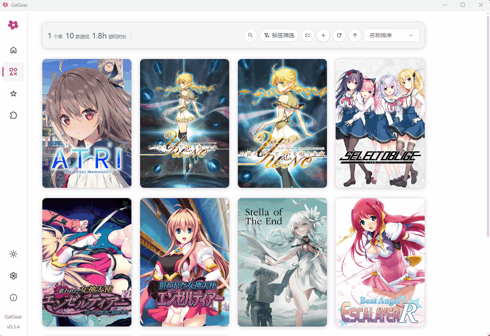
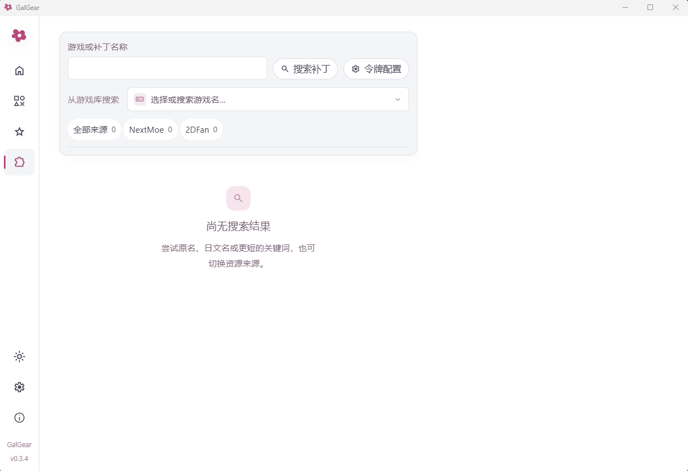

# 🌸 GalGear

**专注于GalGame的管理器，转区超分，补丁搜索管理，多数据源刮削，AI存档搜索。**

Windows x64 · 界面语言支持 简体中文 / 日本語 / English

[简体中文](README.md) · [日本語](README.ja.md) · [English](README.en.md)

交流反馈QQ群：607755362

[下载](https://github.com/CbShuiMu/GalGear/releases/latest) · [快速上手](#-快速上手) · [功能介绍](#-功能介绍) · [反馈问题](https://github.com/CbShuiMu/GalGear/issues)

GalGear 是一个 Windows 上的本地 Galgame 管理工具。把游戏目录加进来，就能看封面、找游戏、整理收藏夹、启动游戏，也能在同一个地方管理存档和补丁。

> 当前发行版为 **v0.4.7（2026-11-12）**。可从游戏详情重新匹配作品资料。改名后匹配到新词条时会同步封面、标签与资料。此版本也优化了首页背景加载，并补充了黑屏与界面无响应的诊断日志。

## 🚀 快速上手

前往 [Releases](https://github.com/CbShuiMu/GalGear/releases/latest) 下载 Windows x64 版本：

- **安装版**：下载 `GalGear_0.4.7_x64-setup.exe`，按提示安装。
- **便携版**：下载 `GalGear-0.4.7-win64-portable.zip`，解压后运行 `GalGear.exe`。

第一次打开，可以按这个顺序来：

首次启动时先选择界面语言。程序会按所选语言设置默认数据源，可在设置中更改。

1. 点击 **添加游戏库**，可一次选择多个存放游戏的文件夹。
2. 扫描后，在确认窗口选择资料来源和对应作品，启动程序可留到首次启动时再选。用 **批量修改** 统一来源，再点 **自动刮削** 查找候选。右下角显示进度与未匹配或失败数，可点 **停止刮削** 结束本轮。核对候选后再保存，已确认的条目会在再次刮削时跳过。
3. 打开游戏详情，检查启动配置，点击启动。（自动备份的开启需要启动游戏并进行一次存档）

## ✨ 功能介绍

| 功能 | 说明 |
| --- | --- |
| 游戏管理 | 多目录管理、标题与别名搜索、排序、多层收藏夹、拖放和批量整理。路径离线时保留条目，磁盘挂载变化后后台重扫。首页沿用游戏库排序，并显示上次游玩日期。 支持拖动单个或多个游戏调整自定顺序，也可用 Alt 加左右方向键移动。 游戏库和收藏夹可用 Alt 加滚轮或 Alt 加上下方向键切换卡面尺寸。 在「设置 → 显示与交互」可切换海报墙或封面与标题，并选择小、中、大三档尺寸。封面与标题模式在封面下方居中显示最多两行游戏名。 |
| 标签与资料 | 支持声优、画师、脚本等制作人员标签筛选，同时支持组合标签筛选，以及 未萌 NextMoe、KunGal、VNDB、Bangumi、月幕Gal、2DFan 资料；封面可单独搜索或选用本地图片。（感谢以上平台） 新增[批评空间资料查询](docs/erogamescape.md)。标签筛选同时支持品牌、开发商、发行商和制作人员。 详情页可长按拖动本地标签排序。详情编辑中可用「重新匹配」选定作品并更新封面、标签与资料。改名后找到唯一且不同的词条时也会同步相应内容。 |
| 内置转区与超分 | 默认不勾选，可在游戏配置中按需开启 Locale Emulator 转区或 Magpie 实时缩放。 悬停或聚焦详情页齿轮可展开转区、超分、自动备份和 AI 分析开关，点击齿轮可打开完整配置。 |
| 封面与主题 | Waifu2x 后台去噪并超分4K 的首页背景；支持主题、明暗模式、语言与字号设置。[封面增强说明](docs/cover-enhancement.md)。 |
| 字体 Hook 与悬浮面板 | 游戏前台默认按 **Shift+T** 打开原生悬浮面板，调整字体、字号、字宽、字距、行距与字重；通过 SimpleFontHook 兼容构建应用到游戏。支持字符集伪装与文字映射，实际效果取决于游戏引擎。[字体面板说明](docs/font-tools.md)。 |
| 游戏截图 | **Shift+S 截图 → 自动复制到剪贴板 → Ctrl+V 粘贴分享**。同时保存原尺寸无损 PNG，支持 Magpie模式下截图和游戏详情下方最近截图预览。 |
| 存档备份 | 在可配置的全局目录按游戏和保存时间管理备份，支持多目录、备注、锁定、恢复预览和退出后自动备份。旧备份校验后迁移，WebDAV 上传和下载由用户发起。[备份与云存储说明](docs/cloud-storage.md)。 在游戏详情的存档卡片点击云上传图标，程序会先测试已保存的 WebDAV 连接，再创建本地快照并上传。 支持专用存档目录和单独选定的存档文件。[存档发现与文件备份](docs/save-discovery.md)。 |
| 补丁管理 | **游戏库联动**—通过选择游戏库内的游戏进行搜索，可将补丁直接存放到游戏目录下的补丁文件夹。NextMoe 托管下载需配置具备 `moyu:files` 权限的应用密钥。 搜索 鲲 Gal、2DFan，支持本地补丁、ZIP / RAR / 7z 自动解压、冲突预览和备份恢复；2DFan 下载需配置代理以及账号令牌。（推荐Nextmoe下载补丁，无需积分且提供直链下载） |
| AI 辅助（测试中） | **AI存档路径搜索**，提供前情提要与 游戏攻略路线图；需自备 API Token，会发送必要游戏文本并产生 API 费用，路线图可能包含剧透。[AI 设置](docs/ai-settings.md)。（路线图和前情提要还在测试中，AI存档搜索首次开启需要启动游戏进行一次存档。） |
| 浏览器授权 | Bangumi、NextMoe 支持内置应用 OAuth 登录，用户令牌保存在本机 Windows 凭据管理器。[授权说明](docs/oauth-callback.md)。 |
| 更新提示 | 启动后后台检查 GalGear 与 Skill 版本。发现 GalGear 新版时弹窗提示，可稍后处理或立即更新。Skill 更新可在设置中查看。 |
| 数据导入 | 支持PotatoVN、ReinaManager、LunaBox等。 |
| 运行日志 | 在程序旁的 `logs/` 记录启动、命令和异常诊断，不自动上传。[日志说明](docs/runtime-logs.md)。 |

功能介绍详细说明与限制

### 🎮 Galgame管理

游戏可以放在不同目录，不必为了使用 GalGear 重新搬家。支持按名称搜索、组合标签筛选和排序，也可以用多层收藏夹整理正在玩、想玩或已经通关的作品。一款游戏能放进多个收藏夹，支持拖放和批量整理。

GalGear 会记录游玩时长和最近游玩时间。计时依赖 GalGear 对游戏进程的检测，玩游戏时请保持 GalGear 运行。

Waifu2x会在后台对封面去噪，并生成经过降噪的首页 4K 背景（保持原比例，长边 3840）。这项功能以 **笔记本 RTX 2060** 为最低配置设计目标，采用小分块、单任务处理；生成成功后才替换，相同封面会复用结果。部署与缓存说明见 [封面增强](docs/cover-enhancement.md)。

### 🏷️ TAG分类

从游戏的标签到游戏资料中的声优，所有属性都可以通过标签筛选。

### 🔎 多个数据源，自动刮削

作品资料可从 **2DFan、VNDB、Bangumi、月幕Gal、未萌NextMoe、KunGal** 中选择，每款游戏可以使用不同来源。简介、制作组、制作人员和标签会保存在本地，也可以自己修改。**感谢以上平台。**

封面可以单独按名称搜索、换来源挑选，或使用本地图片，不影响已经关联的作品资料。点击详情里的标签、制作组或制作人员，就能回到游戏库找相关作品。已经缓存的资料和本地游戏库可以离线浏览。  

界面支持粉色、白粉、白色三种主题色，可分别搭配亮色或夜间模式；语言和字号也能在设置中调整。

### 🔤 游戏内字体 Hook 与悬浮面板

游戏库中的游戏位于前台时，默认按 **Shift+T** 打开或隐藏 Rust 原生悬浮面板。可选择系统字体，调整高度、宽度、字距、行距和字重，并按需设置垂直度量、字符集伪装及日文旧字形/繁简映射。点击“应用到游戏”才加载与游戏进程同位数的 Hook；打开面板本身不会加载 Hook。参数按游戏保存，实际重绘和字体效果取决于引擎。快捷键可在“设置 → 路径与备份 → 存档备份与内置工具”中修改，点击卡片右上角保存后生效。

字体替换基于 [SuQiandYing 的 SimpleFontHook](https://github.com/SuQiandYing/SimpleFontHook)。GalGear 提供自己的悬浮面板、IPC、加载器和兼容补丁；上游及 Detours 的 MIT 版权与许可声明均原样保留，不改变这些组件的许可证。功能范围与兼容限制见 [游戏字体面板](docs/font-tools.md)。

### 📸 游戏截图

在游戏中按默认快捷键 **Shift+S** 截图后，图片会**自动复制到剪贴板**。切换到支持图片粘贴的聊天窗口、文档或图片编辑器，按 **Ctrl+V** 就能直接粘贴分享。

截图默认启用。可在“设置 → 路径与备份 → 存档备份与内置工具”中启用或停用截图、修改快捷键，并点击卡片右上角保存。快捷键仅在游戏库中的游戏位于前台时生效，游玩时需保持 GalGear 运行；与游戏自身快捷键冲突时，可以改用其他组合。

截图同时保存为**原尺寸无损 PNG**，普通窗口截取游戏画面，不包含标准标题栏和边框；使用 Magpie 时，可捕获超分后的画面，保留实际输出分辨率。图片按 UTC 时间命名，保存在游戏目录的 `screenshots/` 文件夹。

游戏详情页的“最近截图”卡片会显示最新图片，右上角可打开截图目录。卡片预览可能缩小，磁盘上的 PNG 保持原尺寸。若复制到剪贴板失败，已保存的图片仍会保留，可从截图目录中获取。

建议使用窗口或无边框模式，并让游戏画面完整显示在屏幕内；独占全屏、受保护画面或第三方覆盖层可能影响截图。管理员权限游戏可能需要一次 Windows 授权，以接收截图快捷键。

### ☁️ 云上存档/存档管理

GalGear 会寻找游戏目录、AppData 和“文档”等位置里的存档，也允许手动指定。  

确认位置后，可以备份多个存档目录、给备份写备注，或锁定一份不想被自动清理的记录。也可以按游戏开启退出后的自动备份。

恢复前会先展示预览，并备份当前存档。游戏正在运行时，请先退出再恢复或应用补丁。

在“设置 → 云存储”保存 **WebDAV** 连接后，退出游戏并点击详情页存档卡片的云上传图标。程序会先检查连接，再备份并上传存档。下载和恢复仍从云存储设置和本地历史发起。换电脑时，两边使用相同的游戏标题；有多个存档位置的，确认顺序也要一致。连接示例和具体步骤见 [云存储说明](docs/cloud-storage.md)。

云备份需要自己点击上传和下载，目前没有后台自动同步。

### 🧩 补丁搜索与管理

可以搜索 **2DFan、鲲 Gal、NextMoe** 的补丁资源，查看原站说明，下载网站提供的可用直链；也可以直接导入本地补丁。需要登录或付费的资源，仍受原站账号和权限限制。（**2DFan资源下载需要配置代理**）

可直接从游戏库选择作品来搜索补丁。“界面预览”中的补丁截图以库中的 **ATRI -My Dear Moments-** 为例，展示两个来源的补丁和存档结果。

本地 ZIP 可直接预览；RAR / 7z 使用随程序附带的 7-Zip。覆盖文件前会列出冲突并保留备份，之后可以恢复。EXE 补丁则使用它自己的安装流程。

已经解压的补丁，可以放进游戏目录的 `patch/` 下，每个补丁单独一个子文件夹。GalGear 会在详情页列出它们，方便安装或切换，不用每次手动复制。

### 📁 AI存档搜索

软件会先扫描一边预设的可能路径。AI存档搜索仅作为补充，新游戏使用该功能需要启动游戏并进行一次存档，退出后点击存档卡片右上角的AI搜索。

### 🤖 AI驱动剧情（测试中）

提供可选的 **AI 前情提要**。在“设置 → AI”配置 DeepSeek、OpenAI、Qwen 或 Kimi 的 API Token 和模型，再到游戏的编辑配置里开启 **AI 分析**。首次准备可能需要一些时间，完成后可以在详情页查看前情提要和当前进度。

另外还有 **AI 路线图**，会在默认浏览器里打开生成的分支与结局图。路线图固定使用 DeepSeek，需要另行配置 DeepSeek；它会分析完整台词，可能包含后续剧情和结局剧透。

这部分还在实验中，能否读取存档和脚本取决于具体游戏，无法保证每款都能用，生成的总结和路线也可能有误。启用时，分析所需的游戏台词、存档信息和作品资料会发给相应的 AI 服务，调用费用由你的 API 账号承担。更详细的用法见 [AI 设置](docs/ai-settings.md) 和 [前情提要说明](docs/ai-summary.md)。

## 🖼️ 界面预览

截图来自 v0.3.1（2026-11-5）；点击图片可查看原图。

更多界面截图：游戏详情与补丁管理

## 🗂️ 数据存放位置

| 内容 | 保存位置 |
| --- | --- |
| 安装版 / 普通运行的配置和游戏列表 | `%APPDATA%/com.galgear.desktop` |
| 便携模式的配置和游戏列表 | 程序旁的 `data/`，由同目录下的 `portable.flag` 启用 |
| 存档备份 | 应用数据目录下的 `save-backups/<游戏名>/<YYYY-MM-DD-HH-mm>/`。在“设置 → 路径与备份”更改全局目录。同一分钟的多份备份追加 `-2`、`-3` 等编号。 |
| 游戏截图 | 游戏目录下的 `screenshots/`（原尺寸 PNG） |
| AI 准备文件和缓存 | 游戏目录下的 `.galgear-ai-summary/` |

便携版迁移时，一起带上程序目录和 `data/`，并带上自定义全局备份目录及程序旁的 `tools/`。启动后会在后台检查 GalGear 和 Skill 版本并显示待更新提示，不自动安装。Skill 不随发行包附带，请在“设置 → 更新 → Skill”点击“更新”安装。已安装的 `Galgear-GalgameReverse-Skill/` 可随程序迁移。

账号 Token、Cookie 和云存储密码保存在本机 Windows 凭据管理器中，换电脑后需要重新配置。从游戏库删除条目会永久清除条目资料、配置和游玩记录，需要重新导入；游戏、存档和备份文件会保留。路径暂时不可用时保留条目并显示红色提示，磁盘挂载变化会自动触发后台扫描。（2Dfan需自行抓取Token以及Cookie）

## 📌 使用须知

- GalGear 管理的是已经安装好的本地 EXE 游戏，不提供游戏本体，也不负责光盘镜像挂载或安装。
- 存档识别并不覆盖所有引擎，第一次备份前请检查位置。Locale Emulator、Magpie 可以在设置-路径与备份中修改配置路径，也取决于游戏与本机环境。
- 资源下载目前一次处理一个任务，暂不支持断点续传。

遇到问题，可以在 [Issues](https://github.com/CbShuiMu/GalGear/issues) 留下软件版本、出错步骤和报错信息。涉及存档或账号时，请先去掉个人信息。

开发资料：[模块结构](docs/architecture.md) · [数据源接入](docs/interface-and-data-sources-2026-10-14.md) · [需求记录](docs/requirements.md)

## 🙏 致谢

GalGear 的部分功能使用了以下开源工具，感谢各项目的开发者与维护者：

- [SimpleFontHook — SuQiandYing](https://github.com/SuQiandYing/SimpleFontHook)：游戏字体 Hook 的上游实现，使用 MIT 许可；GalGear 的兼容构建保留[上游原始声明](docs/licenses/SuQiandYing-MIT.txt)。
- [Microsoft Detours](https://github.com/microsoft/Detours)：Hook 使用的 API 拦截库，保留 [Microsoft MIT 许可](docs/licenses/Detours-MIT.txt)。
- [Locale Emulator（LE）](https://github.com/xupefei/Locale-Emulator)：提供转区启动能力。
- [Magpie](https://github.com/Blinue/Magpie)：提供游戏画面的实时缩放与超分。
- [waifu2x-ncnn-vulkan（waifu2x）](https://github.com/nihui/waifu2x-ncnn-vulkan)：用于封面去噪和首页背景增强。
- [7-Zip](https://github.com/ip7z/7zip)：用于 RAR、7z 等补丁压缩包的解压。

SimpleFontHook 与 Detours 的 MIT 许可要求在软件副本或主要部分中保留版权与许可声明；安装包和便携包均在 `tools/font-hook/` 中附带两份完整原文。各工具保留原有许可证和版权声明。内置工具的使用与上游源码链接见 [内置工具说明](docs/bundled-tools.txt)。

## 📝 更新记录

### v0.4.7

- 新增详情页「重新匹配」，改名后可同步新词条的封面、标签与资料。优化首页背景加载和列表更新，补充 WebView2 故障诊断。 [发布说明](https://github.com/CbShuiMu/GalGear/releases/tag/v0.4.7)

### v0.4.6

- 新增海报墙、封面与标题两种游戏库显示模式，调整三档卡面尺寸的名称，并统一数据源名称和顺序。 [发布说明](https://github.com/CbShuiMu/GalGear/releases/tag/v0.4.6)

### v0.4.5

- 支持多目录添加、卡面尺寸切换、详情标签排序和按文件备份恢复。改进存档搜索和改名后的资料匹配。[发布说明](https://github.com/CbShuiMu/GalGear/releases/tag/v0.4.5)。

### v0.4.4

- 批量自动刮削新增进度、停止和结果汇总。资料查询超时后继续处理其他条目，已确认条目会在再次刮削时跳过。[发布说明](https://github.com/CbShuiMu/GalGear/releases/tag/v0.4.4)。

### v0.4.3

- 新增批评空间资料来源、首次语言选择和游戏库自定排序。改进批量资料确认、启动程序选择、重新扫描和更新提示。[发布说明](https://github.com/CbShuiMu/GalGear/releases/tag/v0.4.3)。

### v0.4.2

- 详情页新增四项快捷开关、存档卡片云上传入口和带提示的目录按钮。WebDAV 连接通过检查后才创建本地快照并上传。[发布说明](docs/releases/v0.4.2.md)。

### v0.4.1

- 新增全局存档备份和旧目录迁移，保留离线游戏条目并随磁盘变化重扫。改进标题与别名搜索、启动器接续识别、首页排序、资料与标签编辑以及游玩时间显示。[发布说明](docs/releases/v0.4.1.md)。

### v0.4.0

- 新增游戏内字体 Hook、Shift+T 悬浮面板和运行日志；随包保留 SimpleFontHook、Detours 的 MIT 许可。[发布说明](docs/releases/v0.4.0.md)。

### v0.3.4

- 新增 NextMoe 补丁下载和内置 OAuth 授权，改进存档识别、首页与更新提示。[发布说明](docs/releases/v0.3.4.md)。

### v0.3.3

- 新增截图与手动 Skill 更新，许可证改为 GPL-3.0-only。详见 [发布说明](docs/releases/v0.3.3.md)。

### v0.3.2

- 支持导入 PotatoVN、ReinaManager 和 LunaBox 游戏库备份，以及导出 PotatoVN 格式数据。
- 改进已验证数据源选择、批量设置、存档资源安装和 Magpie 缩放方案配置。
- 优化首页、封面选择与游戏库布局。详见 [发布说明](docs/releases/v0.3.2.md)。

### v0.3.1

- 修复移除游戏与游戏库后重新添加时，未重新打开游戏资料与启动器确认窗口的问题。
- 修复 2DFan 补丁下载强制直连导致连接失败的问题，下载遵循系统代理设置。
- 已确认存档位置后隐藏其他未确认候选项，覆盖自动识别和手动确认。
- 更新应用图标。

### v0.3.0

- 新增应用内版本检查和更新，下载时校验文件大小与 SHA-256，更新时保留用户数据并支持失败回滚。
- 新增 AI 存档位置查找，改进存档识别、备份、恢复与迁移。
- 改进补丁搜索、下载与本地补丁文件夹管理，随包附带 7-Zip 解码器。
- 优化游戏库拖放、多选、收藏夹与工具栏布局，完善游戏配置与内置工具管理。
- 改进 AI 模型能力判断与 Skills 检查，Skills 继续在运行时按需下载。

### v0.2.1

- 新增主页与手柄导航，优化游戏库和配置编辑体验。
- 扩展资料来源与 AI 服务商，支持 Qwen、Kimi。
- 新增封面增强与自定义背景，改进游玩记录。
- AI 开启前检查软件目录中的宿主和 Skills。后台更新完成后自动启用可用功能；下载或校验失败会保留旧版并提示，下次启动重试。新版本按完整目录替换，删除上游已移除的旧文件。首次下载需要网络和软件目录写入权限，无需安装 Git。

### v0.2.0

AI功能（测试中）：AI前情提要以及AI路线图，AI路线图涉及剧情，介意请勿开启。AI功能开启平均耗时为几十分钟，Deepseek API 平均花费2元。功能开启后AI路线图与AI前情提要每次使用仅花费0.1元左右  
云存档：支持WebDAV协议的云备份  

自动刮削：加入**VNDB、Bangumi，月幕Galgame**，需在设置-数据源中自行配置。

### v0.1.0

主题切换：暗色模式  
补丁搜索：补丁tab可设置-系统中关闭，补丁搜索可从游戏库中选取后搜索**2Dfan、KunGal**平台的补丁  

GalGear 使用 [GPL-3.0-only 许可证](LICENSE)。第三方工具、图标和资料遵循各自的许可与使用条款。
